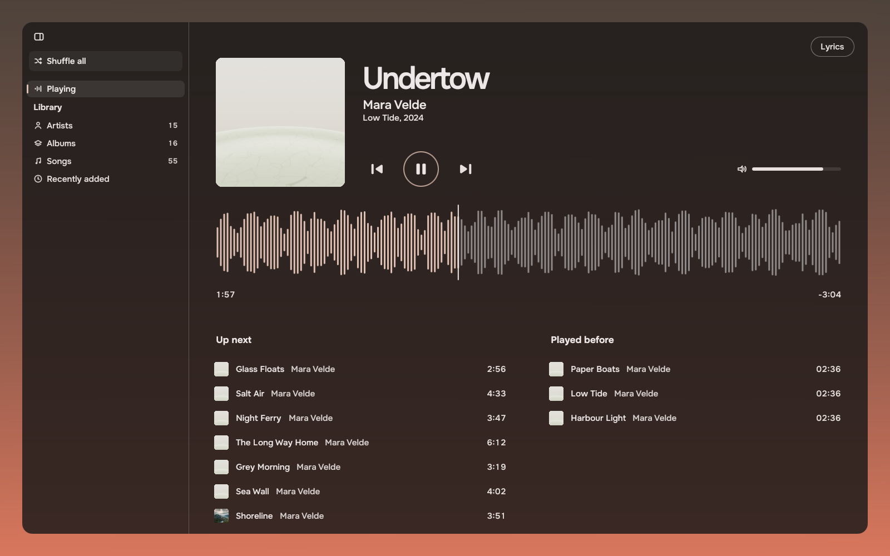
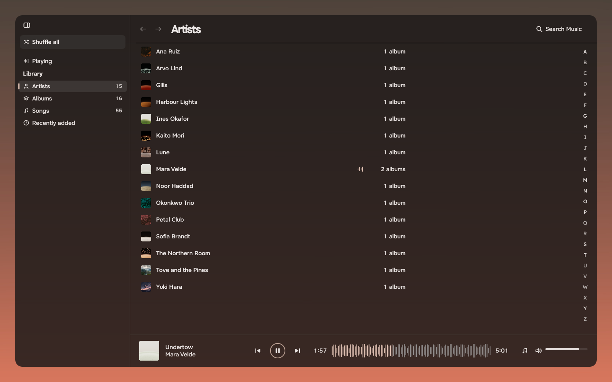
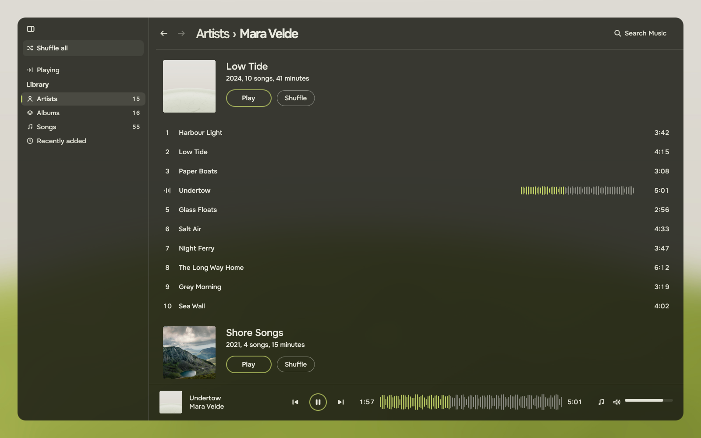
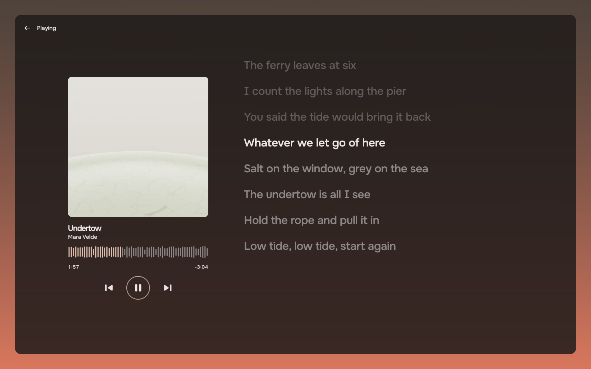
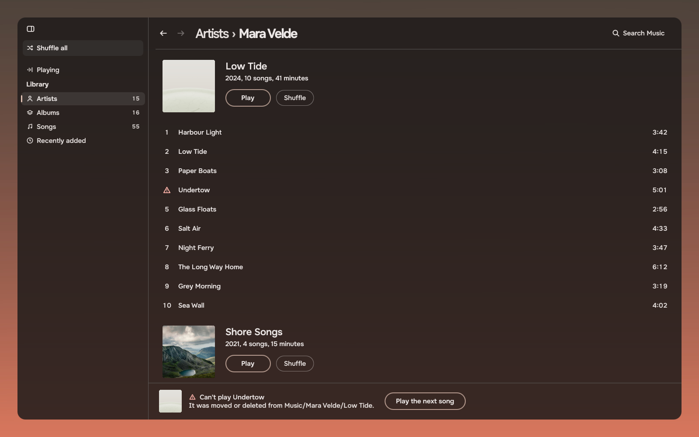

# Music example

A music player made only of [Tacit.Kit](https://github.com/ciscobugger/tacit-kit) parts, as the example to read and
build on when you make an app for Tacit. It is a starting point, not one of Tacit's apps: take it, give it your own
name and make it yours. It plays the music in your Music folder. Every visual in it is a kit part; the app adds
state (the library, the player, where you are) and the arrangement of the parts on each page.



| | |
|---|---|
|  |  |
|  |  |

More in `screenshots/`: every page on both palettes (dusk, Moss), the empty library, search and half width.

## What it shows

- The rail: one action (Shuffle all), Playing, and the Library places with counts. It folds at half width.
- Playing as a stage page: the cover, the song at display size, the transport at 64, the waveform with its playhead,
  the queue and the history as rows with covers.
- Library pages (Artists, Albums, Songs, Recently added): one level each. An artist or an album opens as its own page
  with the path as the title ("Artists > Mara Velde"). The player bar stands at the foot of library pages.
- Lyrics: a stage page with a way back, from an `.lrc` file next to the song.
- States: an empty library (with the sample to try), a song that cannot be played, search over the whole library.
- Nothing opens, scrolls or rearranges itself because of playback. The accent mark shows where the playing music is.

## Run it

You need [Quickshell](https://quickshell.org) 0.3 or later, Qt 6.7 or later with QtMultimedia, `ffmpeg` and `ffprobe`,
and `Tacit.Kit` on the QML import path. On Tacit the kit is installed. Elsewhere:

```sh
QML_IMPORT_PATH=/path/to/tacit-kit/qml qs -p shell.qml
```

| Variable | Does |
|---|---|
| `MUSIC_DIR` | the folder to read (default `~/Music`) |
| `MUSIC_MUTED=1` | mutes the audio output, for tests |
| `XDG_CACHE_HOME` | where the cache goes: `tacit-music-example/` holds covers and waveform peaks |

The kit's colours follow the wallpaper by themselves; nothing in the app sets them.

Keys: Space plays and pauses (in a list, Space or Enter plays the row under the cursor, as the kit's lists do), Left
and Right seek five seconds, Ctrl+F opens Search Music, the arrows move in lists, typing in a list jumps to a name.

## Try it without your music

```sh
tools/make-demo.sh /tmp/music-demo /path/to/folder/with/c1.jpg..c15.jpg
MUSIC_DIR=/tmp/music-demo qs -p shell.qml
```

`make-demo.sh` makes 55 short tones with tags, covers (folder.jpg, cover.jpg and one embedded) and one `.lrc`.
`tools/render.sh /tmp/music-demo screenshots` renders every page offscreen on both palettes (needs Pillow). It starts
the app with `MUSIC_SCENE` set, which loads `tools/Scene.qml`: a test hook that puts the app on a page, saves the
window and quits. Nothing in the app depends on it.

## How it uses the kit

| Where | Parts |
|---|---|
| `shell.qml` | `Rail`, `RailRow`, `RailSection`, `Kit.tokens` for the window ground |
| `LibraryPage.qml` | `PageHeader`, `SearchField`, `PageState` |
| `SongList.qml`, `LibraryRow.qml` | `RowList`, `ListRow` |
| `ArtistsPage.qml` | `RowList`, `ListRow`, `JumpIndex` |
| `AlbumsPage.qml`, `RecentPage.qml` | `CoverGrid` |
| `AlbumList.qml`, `AlbumHeader.qml`, `ArtistHeader.qml` | `RowList` with `section` and a header, `ListRow` `lead`, `leadFigures` and `accessory`, `InlineLink`, `Slab`, `Waveform` |
| `PlayingPage.qml` | `Transport`, `Waveform`, `Slider`, `SectionHeading`, `Slab` |
| `PlayerBar.qml` | `Transport`, `Waveform`, `Slider`, `IconButton`, `Slab` |
| `LyricsPage.qml` | `IconButton`, `Transport`, `Waveform`, `TacitText` inks (`main`, `quiet`, `past`) |

Text is always `TacitText`, symbols always `Symbol`. Sizes, spaces and corners come from `Kit.tokens`. The kit's linter
passes: `python3 tools/lint.py` in the kit's repo, run over this folder.

## A tour of the code

State is three singletons, listed in `qmldir`:

- `Library.qml` reads the folder. `find` lists the files, `ffprobe` reads each file's tags and length, and the cover is
  `folder.jpg` or `cover.jpg` in the album's folder, else the picture inside the first song. `songs`, `albums`,
  `artists` and `recent` are plain arrays that fill in while the files are being read.
- `Player.qml` owns the queue and a place in it, the history, the volume, and one `MediaPlayer`. Waveform peaks come
  from ffmpeg's `astats` and are cached. Pages read `current`, `upNext` and `history`; they never write to a list
  because of playback.
- `Nav.qml` is a stack of pages with a place in it (Back and Forward).

`Jobs.qml` runs commands a few at a time and hands back what they print. It is how both singletons call ffprobe and
ffmpeg.

Pages are one file each: `PlayingPage`, `LyricsPage`, `ArtistsPage`, `ArtistPage`, `AlbumsPage`, `AlbumPage`,
`SongsPage`, `RecentPage`. The four library pages sit in `LibraryPage`, which gives them the header, the search, the
player bar and the empty state. `shell.qml` picks the page with a `Loader`.

Every list is a `RowList` whose rows are `LibraryRow`s, a `ListRow` wired to its list. A row says what is in it (cover,
name, the artist beside it, facts at the end); selection, the keyboard ring, clicks and Enter come from the wiring.
`AlbumList` is one `RowList` for an artist's whole discography: each album is a `section` with its own header, so the
arrows pass from album to album.

`Lrc.js` parses `.lrc` files; `Format.js` has the three small formatters.

## What the kit does not have yet

Found while building this; worked around in the app:

- `ListRow`'s `lead` starts after the symbol column (52 px), so track numbers sit 36 px in from a cover above them.
- `IconButton` can be `checked`, but the app has no shuffle or repeat toggles yet. Shuffle is the rail's action and
  the Shuffle slab.
- No order menu on library pages: the app leaves sorting out (`MenuButton` and `Menu` would carry it).

## Licence

MIT, see `LICENSE`. `sample/Sample.mp3` is a tone sequence made with ffmpeg for this repo.
